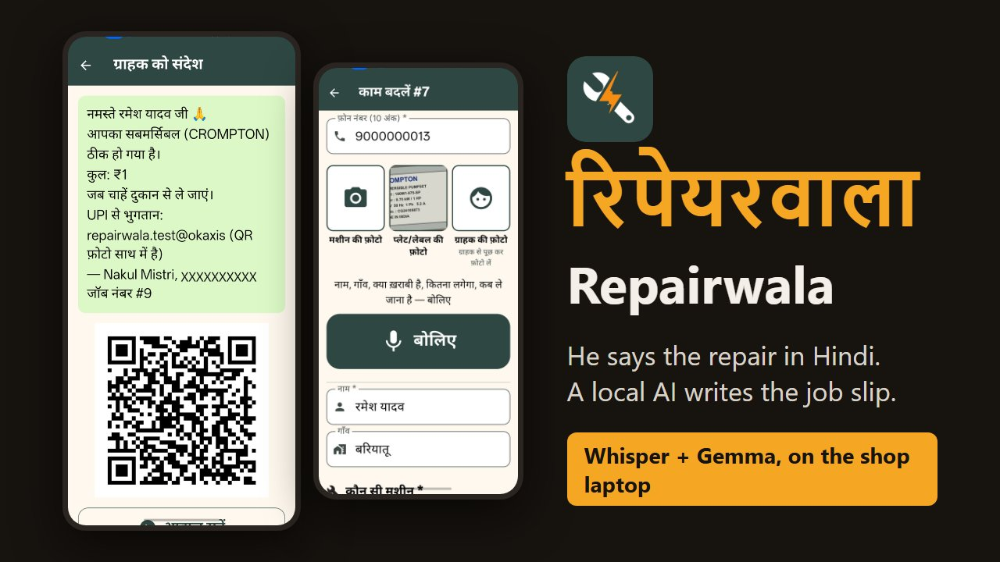
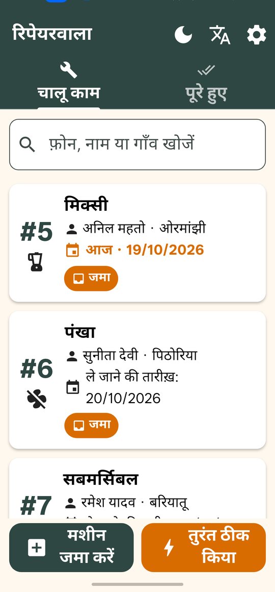
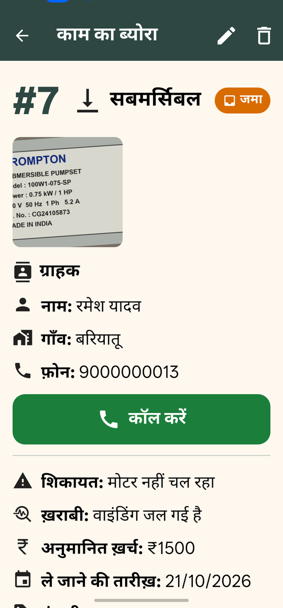
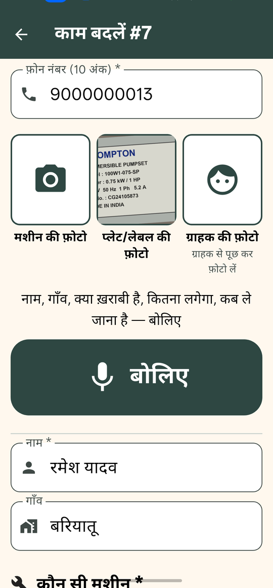
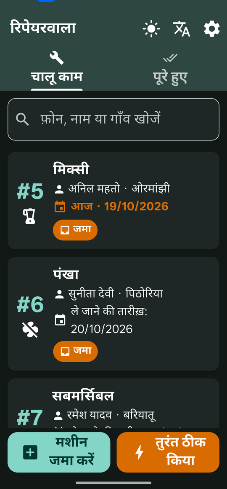
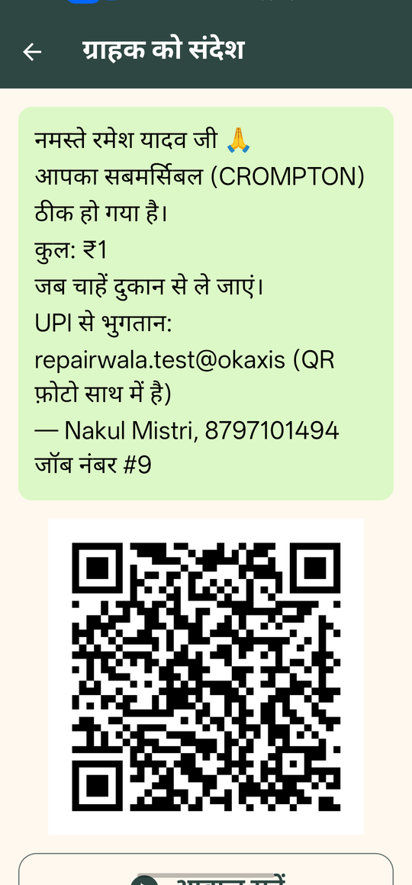
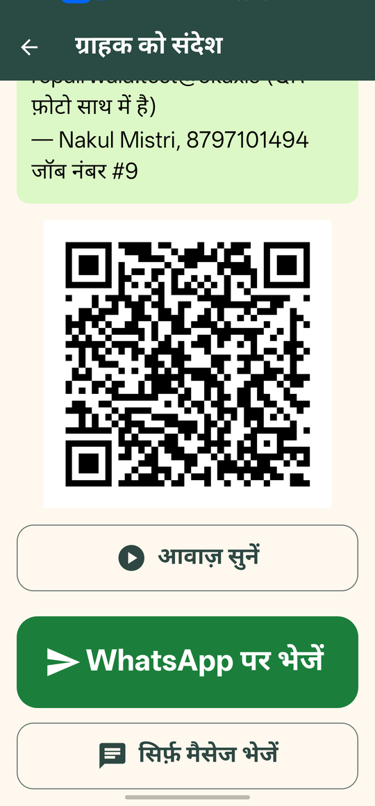

<p align="center"></p>

# रिपेयरवाला · Repairwala

**The record book my father's repair shop never had.** People bring water pumps, submersibles, fans, coolers, mixer-grinders and heaters to his electrical repair shop at home. Until now nothing was written down: no slip, no photo, no history. Repairwala is a Hindi-first Android app for him: he takes a photo of the machine, **says the job out loud in Hindi**, and a local open-weight model fills in the job card. When it's fixed, the customer gets a WhatsApp message with a Hindi voice note and a UPI QR for the exact amount.

Speech-to-text (whisper.cpp) and the language model (Gemma 4 in Ollama) run **on the shop laptop**, so customers' names, numbers and photos never leave the shop.

Built for DEV's [Hacktoberfest Open-Source AI Challenge, Week 2: Side Hustle](https://dev.to/challenges/hacktoberfest-week2-2026-10-12).

[](https://youtu.be/9ohNuEXWs7g)

▶ **[Watch the 97-second demo video](https://youtu.be/9ohNuEXWs7g)**

## Features

- **Speak the job, don't type it.** *"रमेश यादव, बरियातू से, सबमर्सिबल मोटर नहीं चल रहा, वाइंडिंग जल गई है, पंद्रह सौ लगेगा, परसों ले जाना"* becomes a job card: name, village, machine, fault, ₹1500 estimate, and a pickup date two days from today. The model only reads the Hindi; code works out the date (*कल*, *परसों*, *बुधवार को*) and checks the amounts, so nothing is invented.
- **Photos as proof.** The machine, its rating plate and (with permission) the customer. Gemma reads the brand, model, rating and serial number off the plate photo.
- **Every customer's history.** Type a phone number and past jobs appear: *"last time, same pump, coil replaced, ₹1500"*.
- **Two flows.** *मशीन जमा करें* for a machine left at the shop, with a job number to write on it, and *तुरंत ठीक किया* for a repair done while the customer waits.
- **"It's fixed" on WhatsApp.** One tap opens WhatsApp in the customer's chat with the Hindi message, an ElevenLabs voice note and a UPI QR for the exact amount.
- **Built for its user.** Big buttons and text, Hindi first with an English switch, light and dark mode, required-field checks, edit and delete, and a Cancel button on every wait.

| Today's jobs | A job card | Filling it in | Dark mode |
|---|---|---|---|
|  |  |  |  |

| "It's fixed": the message | Voice note and WhatsApp |
|---|---|
|  |  |

<sub>Screenshots use made-up customers and a ₹1 test amount.</sub>

## How it works

```
Shop phone (Flutter app, Hindi)  ── shop Wi-Fi ──>  Shop laptop (Node server)
  camera: machine, plate, customer                     SQLite + photos folder
  mic: says the job in Hindi       ──────────────>     whisper.cpp (Hindi speech -> text)
  job list, history by phone                           Gemma 4 in Ollama (text -> job card,
  "repaired" -> WhatsApp share                           rating plate photo -> details)
                                                       UPI QR with the exact amount
                                   only the message ->  ElevenLabs (Hindi voice note)
```

1. The app records 16 kHz WAV and the laptop's **whisper.cpp** (`large-v3-turbo`, Hindi) turns it into Devanagari text. About 12 s for a 10 s clip on a CPU-only laptop.
2. **Gemma 4** (`gemma4:e4b` in Ollama) reads the text into a JSON schema: name, village, machine, complaint, fault, amount, and the pickup words as said. Code turns *"परसों"* into a date and rejects odd amounts. 5 to 25 s.
3. The same model reads the **rating plate photo** in the background (about a minute) and fills in the brand, model, rating and serial number.
4. When the machine is repaired, the server writes the Hindi message, asks **ElevenLabs** for a voice note (only the message text is sent), and draws a **UPI QR** for the exact amount. The app hands all three to WhatsApp.

The API between the app and the server is in [docs/api.md](docs/api.md).

## Run it

You need a Windows, Mac or Linux laptop and an Android phone on the same Wi-Fi.

**1. Local AI on the laptop**

- [Ollama](https://ollama.com) with Gemma 4: `ollama pull gemma4:e4b`
- [whisper.cpp](https://github.com/ggml-org/whisper.cpp/releases) and the [`ggml-large-v3-turbo-q5_0.bin`](https://huggingface.co/ggerganov/whisper.cpp) model, started as a server:

  ```bash
  whisper-server -m ggml-large-v3-turbo-q5_0.bin --host 127.0.0.1 --port 8178 -l hi
  ```

**2. The shop server** (Node.js 22.9 or newer)

```bash
cd server
npm install
cp .env.example .env   # set SHOP_TOKEN, SHOP_NAME, UPI_ID, UPI_NAME, ELEVENLABS_API_KEY
npm start
```

It prints the address for the phone, for example `http://192.168.1.5:3000`. On Windows, allow port 3000 through the firewall on your private network.

**3. The app**

Install the APK from [Releases](https://github.com/Rahullkumr/repairwala/releases), or build it with Flutter 3.44: `cd app && flutter build apk --release`. In the app's **सेटिंग** (Settings), enter the server address and the `SHOP_TOKEN`, then tap **जाँचें** (Check).

Pushing to `main` builds a signed APK and publishes it to Releases (see [.github/workflows/release-apk.yml](.github/workflows/release-apk.yml)). Day-to-day work happens on `dev`.

## Limitations

- **The laptop has to be on.** The app is a front end; speech, the model and the data live on the shop laptop, on the shop Wi-Fi only.
- **CPU speed.** On a laptop without a GPU, understanding a job takes 20 to 40 seconds and reading a plate about a minute. Every wait shows a timer and a Cancel button.
- **Whisper invents words for silence.** A recording with no speech can come back as nonsense; the text is shown so it can be corrected or spoken again.
- **WhatsApp needs a tap.** The app opens the customer's chat with everything attached; sending is one tap. Fully automatic sending needs the WhatsApp Business API.
- **UPI on personal accounts.** Some payment apps limit amount-prefilled QRs for personal UPI IDs. Test with ₹1 first.

## Built with

[Flutter](https://flutter.dev) · [Node.js](https://nodejs.org) + [Fastify](https://fastify.dev) + `node:sqlite` · [whisper.cpp](https://github.com/ggml-org/whisper.cpp) · [Gemma 4](https://ollama.com/library/gemma4) in [Ollama](https://ollama.com) · [ElevenLabs](https://elevenlabs.io) · [qrcode](https://www.npmjs.com/package/qrcode)

## License

[MIT](LICENSE)
